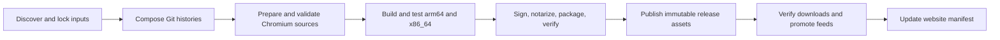

# Builds, releases, and automatic updates

Status: browser release pipeline remains proposed. Local preparation/build tooling
and a configuration-check workflow exist; no recurring browser schedule or
publishing job is enabled. See [current build readiness](building.md).
Initial targets: macOS arm64 and x86_64, with separate DMGs and update feeds.

## Daily integration

A scheduled job discovers upstream changes and produces an immutable candidate
lock. Skip rebuilding when all effective inputs are unchanged. Allow manual
dispatch for urgent fixes. Deduplicate candidates by input hash and serialize
promotion per release channel.

Chromium stable determines the target, independently of downstream release
cadence. Before promotion, query stable again and require the candidate to match
or supersede it; an unavailable freshness check blocks promotion. A newer stable
release discovered during compilation requires a new integration candidate.
Older development builds may finish for diagnostic evidence, but cannot be
promoted as current releases. This is the required release policy; automatic
promotion and its final freshness gate are not yet implemented.

GitHub Actions can coordinate the jobs; a reliable external cron can dispatch the
same workflow if needed. Use an off-hour-minute schedule and a missed-run monitor:
[GitHub documents](https://docs.github.com/en/actions/reference/workflows-and-actions/events-that-trigger-workflows#schedule)
that scheduled jobs can be delayed/dropped and inactive public repositories can
have schedules disabled. Do not equate a scheduled workflow with a daily guarantee.

The state machine is:

Any failed gate blocks promotion. Record the exact component, patch/commit,
Chromium version, logs, and last successful release. Distinguish Git conflicts,
patch rejects, dependency failures, compiler failures, test failures, and Apple
service failures. Keep the previous feed live. Retry transient failures against
the same locked candidate, without reusing a published build number.

## Build environment

The owner requires no additional CI spend. Start with this Mac as a self-hosted
GitHub Actions runner and keep download/compiler caches on local disk. The manual development browser workflow exists; storage/Xcode/Metal preflight
passes. The first arm64 build and headless runtime smoke test passed, with
compilation/linking taking 2h21m29s on this Mac; see [build evidence](builds/2026-11-05-arm64.md).
Continue measuring storage, memory, build duration, and cost before promising a daily cadence;
one successful development run does not establish unattended release reliability. Pin Xcode/SDK, compilers, Python,
Sparkle, source archives, and relevant build tools. Namespace caches by toolchain,
architecture, flags, and source inputs, and periodically verify clean builds.

Helium's macOS tooling supports x86_64 builds on Apple silicon. That can simplify
compilation capacity, but still validate the Intel app on Intel hardware. Use
separate source/output directories for architecture-specific configuration and
packaging. Never package whichever binary happens to be left in `out/Default`.

Separate untrusted PR checks from release jobs. Pin third-party Actions and avoid
running arbitrary PR code on a persistent signing host. Build jobs receive no
signing secrets. The signing/publishing step accepts only the exact artifacts
and provenance of the validated candidate; credentials are scoped to that step.

## Release gates

1. Validate the lock, source reachability, clean input trees, PR dependency order,
   core/platform gitlink agreement, and toolchain availability.
2. Run upstream series/config validation and a fresh full source preparation.
   Require patch application without fuzz or rejects. Verify substitutions,
   resources, and generated version metadata, not only patch files.
3. Build both targets and run focused tests for changed features plus browser
   smoke checks: startup, navigation, tabs/windows, profile persistence,
   settings, extension installation/update, and uBlock operation.
4. Check the packaged identity, profile/keychain paths, architecture, minimum OS,
   service endpoints, updater feed, and embedded Sparkle key.
5. Sign nested components using Chromium's signing machinery; notarize/staple
   the app and DMG, then validate signatures and Gatekeeper acceptance.
6. Test an installed previous Lune release updating to the candidate through a
   staging feed on both architectures, followed by relaunch and profile checks.
   Also test a bad signature, incompatible OS, and wrong-architecture offer.
7. Verify published downloads, hashes, source/provenance attachments, and feed
   consistency before promotion. Verify feed readback afterward.

At bootstrap, keep public auto-promotion disabled until the two-release update
exercise passes. After that, routine candidates may publish automatically under
these gates without daily manual approval. New feature selection and conflict
resolution remain deliberate changes to the reviewed input policy.

## Reuse Xelium's mechanisms, adapt the implementation

[Xelium's release script](https://github.com/minervanet/xelium-macos/blob/c5a6bfbeb2ec1b8caa33fa987b0947d771f7ea42/release.sh)
builds, packages, invokes Sparkle `sign_update`, creates an appcast, and publishes
with `gh release`. Its [packager](https://github.com/minervanet/xelium-macos/blob/c5a6bfbeb2ec1b8caa33fa987b0947d771f7ea42/sign_and_package_app.sh)
uses Chromium signing scripts, `notarytool`, `stapler`, and a DMG.

Use that sequence with Lune's Developer ID, bundle/profile/keychain identity,
Sparkle key pair, repository, feeds, and artwork. Parameterize architecture and
generate release notes from the lock. Do not copy Xelium's hard-coded arm64 paths,
personal certificate, public key, sibling tool locations, or fixed feature list.

Xelium can replace release assets with `--clobber` and commits its appcast to
`main`. Lune should instead assign a unique version to every public build and
keep release outputs outside the source branch. Its draft mode still reaches
the appcast commit/push block; a Lune draft must never advance a public feed.

## Versioning and publication

Use a monotonically increasing numeric Lune build number for `CFBundleVersion`
and Sparkle's `version`. Allocate it centrally with a serialized writer; timestamps
alone can collide or go backwards. Use the same candidate build number for both
architectures and include it in release tags and filenames. Record Chromium,
ungoogled, and Helium versions separately in the manifest and About/release notes.
An upstream version string alone cannot distinguish two Lune patch builds.

Proposed artifact naming: `Lune-<version>-<build>-macos-<arch>.dmg`.
Publish DMGs, SHA-256 sums, source locks, patch provenance, corresponding source
availability, and validation results under an immutable release tag on `main`.
Keep permanent component tags reachable as described in [architecture](architecture.md).

Publish and verify both architecture assets before changing either stable feed.
Use a conditional/serialized feed update so a slower old job cannot replace a
newer release. With separate feeds, promotion is not a cross-file atomic
transaction; both feeds must always reference already-available assets, and the
job must detect and repair partial promotion.

## Sparkle delivery

Use Sparkle 2 as Xelium does, with one Lune-owned HTTPS feed per architecture and
channel, for example `updates.<domain>/macos/stable/arm64/appcast.xml` and its
`x86_64` counterpart. These are placeholders, not selected domains. Separate
feeds prevent an Intel client receiving an arm64-only enclosure. Test any future
shared-feed filtering before adopting it.

Embed Lune's public key and matching feed URL at build time. Keep the Ed25519
private key in signing storage; Apple code signing and Sparkle update signing
are separate responsibilities. Sign the final notarized/stapled DMG bytes and
do not modify them afterward. Configure automatic checks with a daily interval
and preserve a manual Check for Updates action. Follow
[Sparkle's documentation](https://sparkle-project.org/documentation/) for key
management, appcast fields, and supported OS constraints.

Start with full downloads. Delta updates can follow after the full-update path
works. Retain compatible historical feed entries for older supported OS versions.
Keep staging and public feeds separate and avoid silently changing a user's
chosen channel.

If a release is defective, remove its offer for clients that have not updated.
For already-updated clients, publish a corrective build with a higher version;
do not assume Sparkle can downgrade the app or that an older browser can safely
read a newer profile. Website/download metadata follows successful feed promotion.

## Security freshness reporting

Record last poll, latest Chromium stable, latest ungoogled stable, selected Helium
base, currently shipped Chromium, and the reason for any lag. Notify on meaningful
lag, integration failure, missed scheduling, and promotion failure. A daily rebuild
of old inputs does not improve the browser's security profile.
